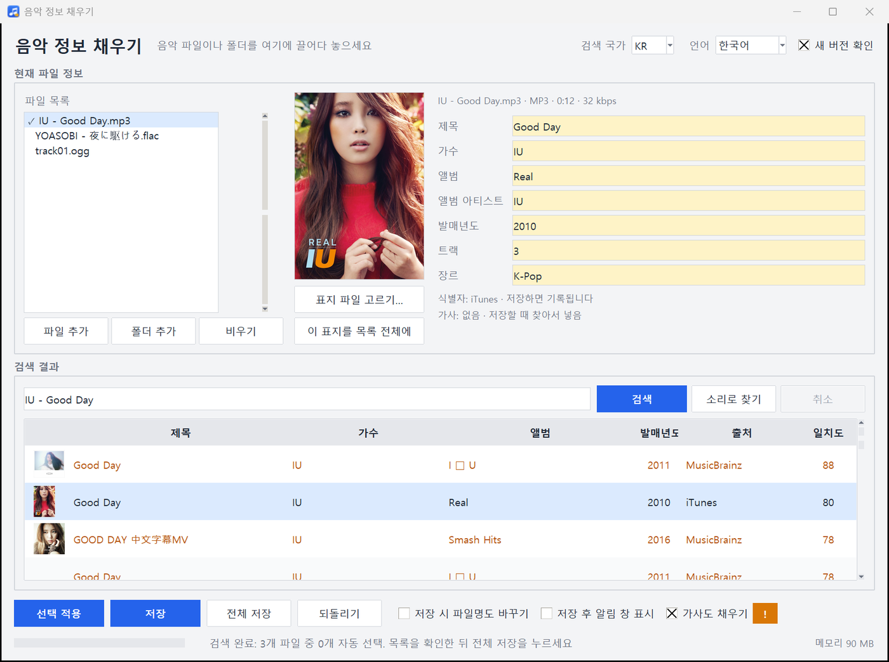
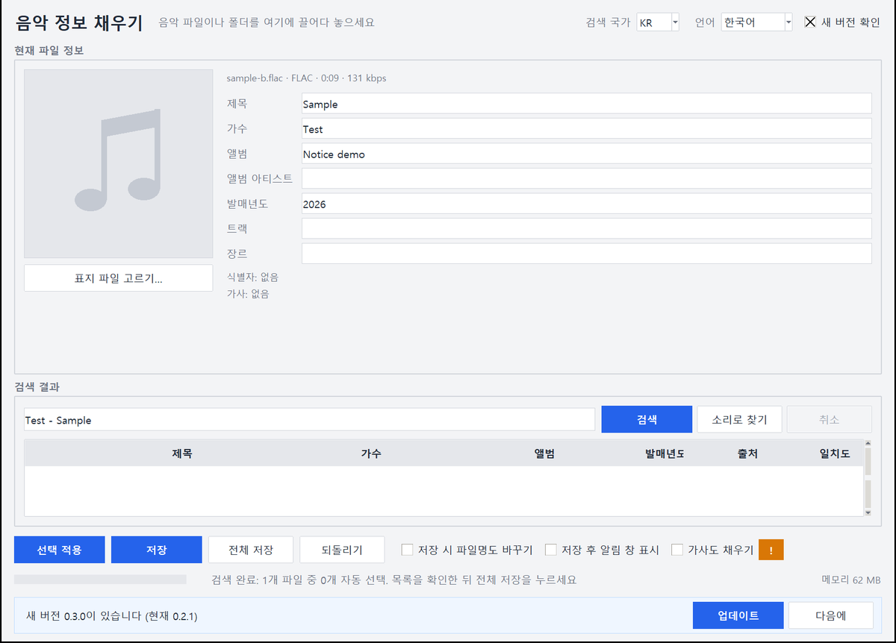

# 音乐标签补全 (Music Tag Filler)


[한국어](README.md) · [English](README.en.md) · [日本語](README.ja.md)

> **文件不会上传到互联网。** 只发送搜索关键词和声音指纹（一串数字）。仅检查新版本例外（只发送工具名和版本，每天一次，可在设置中关闭）。

把缺少标题、歌手、专辑或封面的 mp3 / flac / m4a / ogg 拖进来：上半部分显示文件里已有的信息，下半部分显示从 iTunes、MusicBrainz、AcoustID 找到的候选，选中后写入文件。无服务器（仅检查新版本例外，可关闭），无需安装，按下保存之前不会改动文件。



## 下载

- **可执行文件**：在 [Releases](https://github.com/microhan1/music-tag-filler/releases) 下载 `music-tag-filler.exe` 并双击运行，无需安装。（exe 未签名，若 SmartScreen 提示，请选择"更多信息 → 仍要运行"。）
- **从源码运行**：

```bash
pip install -r requirements.txt
python main.py
```

## 使用方法

1. 把音乐文件或文件夹拖到窗口上。程序会从文件名读取 `歌手 - 标题` 并立即开始搜索。
2. 在下方表格中选择候选，点击**应用所选**（或双击）。改动的字段显示为黄色，也可以手动修改。
3. 点击**保存**。原始标签保存在 `<文件名>.tagbak.json` 中，**撤销**可将文件逐字节恢复原状。

放入多个文件时，每个文件都会搜索，匹配度 90 以上的第一个候选会被自动选中（灰色勾）。逐个检查后点击**全部保存**。对 `track01.mp3` 这类没有有效文件名的文件，请点击**按声音查找**。

**批量设置封面**：放入多个文件（例如整个专辑文件夹）时，封面预览下方会出现**将此封面用于全部**按钮。

1. 选择一个有封面的文件。通过应用候选、**选择封面图片**或把图片拖到封面区域设置的封面也可以。
2. 点击**将此封面用于全部**并确认，列表中的其他文件都会使用同一封面。
3. 点击**全部保存**后才会写入文件。撤销仍按文件逐个进行。

```bash
python main.py song.mp3                      # 列出带编号的候选并询问
python main.py music_folder --auto --rename  # 匹配度 >= 90 时不询问直接保存，并重命名
python main.py music_folder --auto --lyrics  # 也为没有歌词的文件写入歌词
python main.py song.mp3 --undo               # 从备份恢复原始标签
```

`python main.py --help` 会用操作系统语言（한국어 · English · 中文 · 日本語）显示选项。

exe 也接受相同的参数（`music-tag-filler.exe song.mp3 --auto`）。但它是窗口模式程序，某些环境下控制台不会显示输出；此时请把输出重定向到文件（`> log.txt`）或从源码运行。有参数但没有可输出的控制台时，会打开加载了这些文件的窗口。

测试：`pip install -r requirements-dev.txt`，然后 `python -m pytest tests`。测试素材来自 `samples/` 中的音频。

## 填入歌词

打开选项行中的 **同时填入歌词** 后，保存时会为没有歌词的文件写入歌词。默认关闭。第一次打开时以及按旁边的 **!** 按钮时会显示注意事项。

- 歌词来自 [LRCLIB](https://lrclib.net/)，这是由用户提交的免费歌词库。只发送曲名、歌手和时长。
- 已有歌词的文件不会被改动。只为歌词而保存的文件如果没找到歌词，不会写入任何内容。
- 歌词栏里只有 `[COWON S9]`、`[3 LINES]` 这类播放器标记时视为空，会写入歌词。界面上显示“只有标记而非歌词 · 视为空”，“撤销”可恢复原来的标记。找不到歌词时标记保持不变。
- 本着“宁缺毋错”的原则，只有以下条件全部满足时才写入：
  - 歌手一致。只有标题相同的其他歌手的歌曲不会被使用。
  - 版本一致。`Instrumental`、`Off Vocal`、`Karaoke` 或 `TV size` 标记必须两边都有或都没有。伴奏文件根本不会查找。
  - 时长相差 3 秒以内；如果是带时间标记的歌词，不能超过歌曲结尾。
  - 该曲已提交的歌词内容彼此一致。同一段文字重复提交只算一份。内容有分歧时不写入。
  - 同一首日语歌曲既有日语原文记录又有罗马字记录时，使用原文；只有罗马字记录时写入罗马字歌词。
  - 只有一条记录且没有时间标记、无从比对时，如果歌词相对歌曲时长过长（每秒超过 12 个字），不写入。曾有 87 秒的前奏曲被登记了另一首歌的全部歌词。
- 只写入不带时间标记的普通歌词。
- 如果 LRCLIB 上只有标为“无歌词”的记录，则不写入并如实显示。曾见到有歌词的歌曲被这样标记，所以不称其为“伴奏”。
- 文件信息下方的 **歌词：** 一行显示结果。有歌词时可用 **查看歌词** 查看内容。
- LRCLIB 服务器经常繁忙。会稍等后再次查询，仍失败时只保存标签并显示“服务器繁忙”。再次保存会重新查找。连续 5 首失败时，本次保存不再查找歌词。
- “撤销”会恢复到写入歌词之前的文件。
- 歌词受版权保护。请只用于个人收藏的文件，不要分享含有歌词的文件。

| 格式 | 歌词标签 |
| --- | --- |
| mp3 | `USLT`（语言 `und`） |
| flac · ogg | `LYRICS`（读取时也把其他软件写入的 `UNSYNCEDLYRICS` 视为歌词） |
| m4a | `©lyr` |

## 艺术家标识符

同一位歌手即使被存成 `岡田 有希子`、`岡田有希子` 或 `Yukiko Okada`，以后也能归为同一人：保存时会在名称之外写入标识符。标签名与 MusicBrainz Picard 相同，其他工具也能读取。

| 内容 | mp3 | flac · ogg | m4a |
| --- | --- | --- | --- |
| MusicBrainz 艺术家 ID | `TXXX:MusicBrainz Artist Id` | `MUSICBRAINZ_ARTISTID` | `MusicBrainz Artist Id` |
| 专辑艺术家 ID | `TXXX:MusicBrainz Album Artist Id` | `MUSICBRAINZ_ALBUMARTISTID` | `MusicBrainz Album Artist Id` |
| 专辑（发行）ID | `TXXX:MusicBrainz Album Id` | `MUSICBRAINZ_ALBUMID` | `MusicBrainz Album Id` |
| 录音 ID | `UFID:http://musicbrainz.org` | `MUSICBRAINZ_TRACKID` | `MusicBrainz Track Id` |
| 排序用名称（如 `Okada, Yukiko`） | `TSOP`、`TSO2` | `ARTISTSORT`、`ALBUMARTISTSORT` | `soar`、`soaa` |
| iTunes 艺术家 ID | `TXXX:iTunes Artist Id` | `ITUNES_ARTISTID` | `iTunes Artist Id` |

- 应用 MusicBrainz 候选会写入 MusicBrainz ID 和排序名称；应用 iTunes 候选会写入 iTunes 艺术家 ID；合并的候选两者都写。
- 有多位艺术家时写入多个 ID（mp3 中用 `/` 连接）。自动选择的文件也会写入。
- 字段下方的“标识符”一行显示该文件已有的标识符。撤销也会恢复标识符。
- 显示用的歌手名使用候选的原文。把 `settings.json` 的 `artist_name_preference` 设为 `"latin"`，在 MusicBrainz 明确提供拉丁字母名称时使用该名称（默认 `"original"`）。

## 补全标签之后：整理文件夹

标签补全后，可以用 [音乐文件夹整理 (music-folder-organizer)](https://github.com/microhan1/music-folder-organizer) 把文件整理成 `歌手/专辑/01 - 标题.mp3` 结构并清理重复文件。无需联网，执行前先显示预览，每次整理都可以撤销。

- 这里写入的 MusicBrainz·iTunes 艺术家 ID 可以把 `岡田 有希子`、`岡田有希子` 这样的不同写法合并到同一个文件夹（音乐文件夹整理 v0.1.2 及以上）；排序名称可在整理规则中用 `{artist_sort}`。
- 本工具的备份 `<文件名>.tagbak.json` 会随音乐文件一起移动，所以整理文件夹之后，这里的 **撤销** 依然有效。

## 按声音查找的准备

- 需要 `third_party/fpcalc.exe`（Chromaprint），仓库已附带。若缺失，请从 [Chromaprint Releases](https://github.com/acoustid/chromaprint/releases) 下载 `chromaprint-fpcalc-*-windows-x86_64.zip`，把 `fpcalc.exe` 放入 `third_party/`，或在 `settings.json` 的 `fpcalc_path` 中填写路径。
- Releases 中的 exe 已内置 AcoustID 应用密钥，可直接使用。从源码运行时，请在 [acoustid.org/new-application](https://acoustid.org/new-application) 免费申请密钥，填入 `settings.json` 的 `acoustid_key`，或写入单行文件 `acoustid_key.txt`（不会提交到仓库），build.bat 会把它打包进 exe。

## 检查新版本

启动时为了确认是否有新版本，只把工具名（`musictag`）和版本发送到 책갈피（Chaekgalpi）服务器（chaekgalpi.co.kr）。不发送任何文件，每天最多检查一次，可在设置中关闭（顶部的 **检查新版本**）。检查在窗口打开后于后台进行，无法连接时不显示任何内容。

有新版本时，窗口底部会出现一行提示。按 **更新** 会打开 Chaekgalpi 的工具页面；按 **以后** 会隐藏提示，该版本不再提醒（有更新的版本时会再次提醒）。不会自动下载或替换。



*图：提示行的界面。截图时使用了伪造的服务器响应（新版本 0.3.0）。*

## 信息来源

| 来源 | 用途 | 条款 |
| --- | --- | --- |
| [iTunes Search API](https://performance-partners.apple.com/search-api) | 歌曲、专辑、封面 | [Apple Media Services 条款](https://www.apple.com/legal/internet-services/itunes/) |
| [MusicBrainz](https://musicbrainz.org/) | 歌曲、专辑、发行信息 | [MusicBrainz API 规则](https://musicbrainz.org/doc/MusicBrainz_API/Rate_Limiting) |
| [AcoustID](https://acoustid.org/) | 声音指纹 → 录音 ID | [AcoustID 服务条款](https://acoustid.org/webservice) |
| [Cover Art Archive](https://coverartarchive.org/) | 专辑封面 | [关于 CAA](https://musicbrainz.org/doc/Cover_Art_Archive) |
| [LRCLIB](https://lrclib.net/) | 歌词（仅在打开选项时） | [API 文档](https://lrclib.net/docs) |
| [Chaekgalpi 工具](https://chaekgalpi.co.kr/tools/musictag) | 检查新版本（每天一次，可关闭） | 只发送工具名、版本和系统类别（`win`） |

iTunes 韩国商店不销售音乐，搜索结果总是为空，因此所选国家没有结果时会自动改用美国商店。歌名和歌手名按来源返回的原文显示。

## 不做的事

- 不会把音乐文件上传到任何地方，只发送关键词和声音指纹。仅检查新版本例外（只发送工具名和版本，每天一次，可在设置中关闭）。
- 不会自动下载或替换新版本。
- 只有打开选项时才获取歌词，已有的歌词不会被更改。不生成 `.lrc` 文件（需要时请用 [LRCGET](https://github.com/tranxuanthang/lrcget)）。
- 没有下载、转换、播放功能。
- 不关联流媒体账户。
- 不抓取没有官方 API 的服务（Melon、Bugs、Genie 等）。
- 按下保存之前不会改动文件。

## 与 MusicBrainz Picard 的区别

- 无需设置："拖入、选择、保存"三步完成。
- 同时使用 iTunes 搜索，对韩语、日语、华语音乐和封面更有效。
- 默认韩语界面，可随时切换为英语、中文、日语。

## 发送反馈

遇到问题、用着不顺手或想要新功能，可以点窗口顶部的 **发送反馈**，或在 [chaekgalpi.co.kr/tools/musictag#feedback](https://chaekgalpi.co.kr/tools/musictag#feedback) 提交，无需登录。按钮只是在浏览器中打开那个页面，程序本身不发送任何内容。[GitHub Issues](https://github.com/microhan1/music-tag-filler/issues) 也照常受理。


*图：窗口顶部一行（韩语界面）。「새 버전 확인」（检查新版本）右边就是 **发送反馈** 按钮。*

## 许可证

MIT，见 [LICENSE](LICENSE)。
附带的 `third_party/fpcalc.exe`（Chromaprint）为 LGPL-2.1，全文见 [third_party/LICENSE-chromaprint](third_party/LICENSE-chromaprint)。
